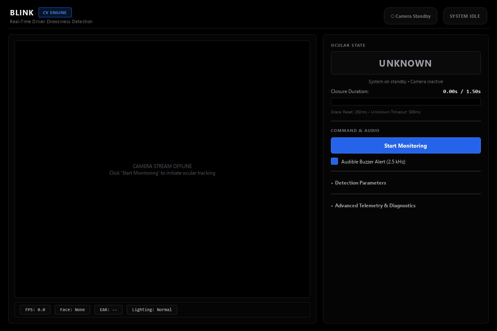
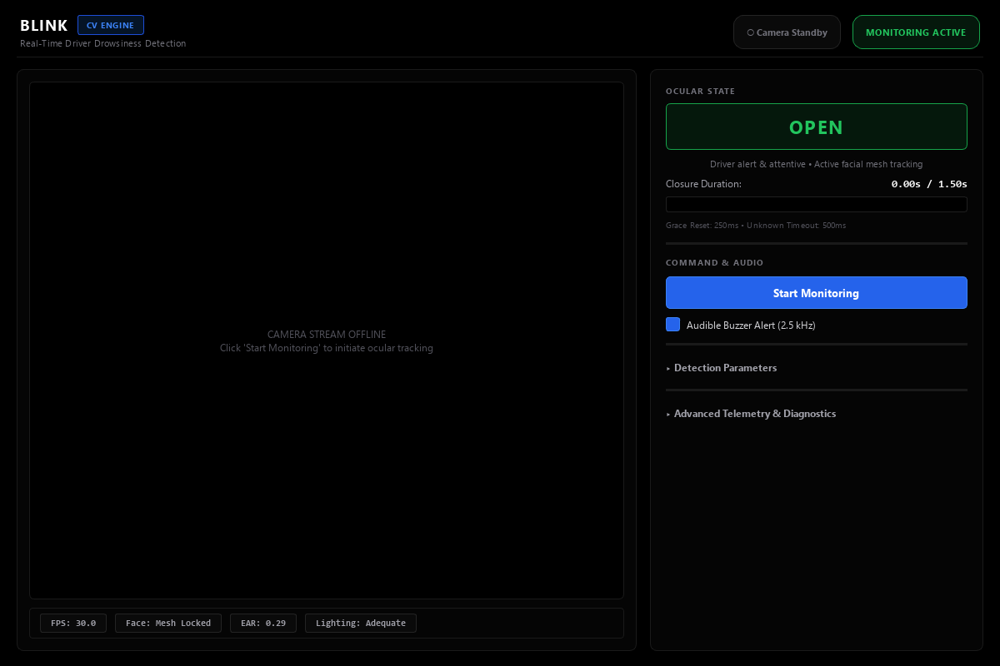
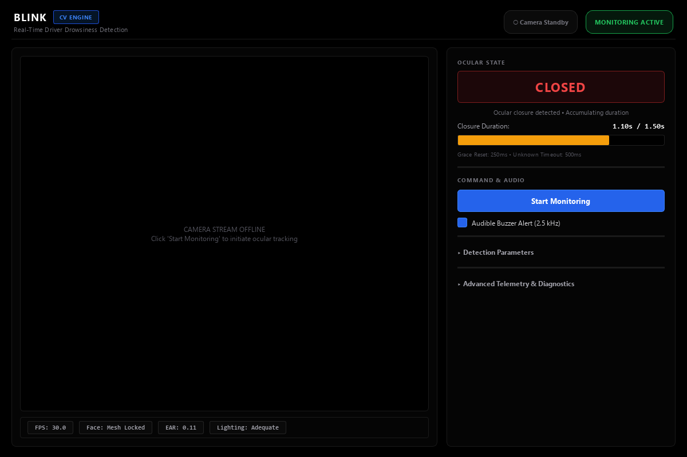
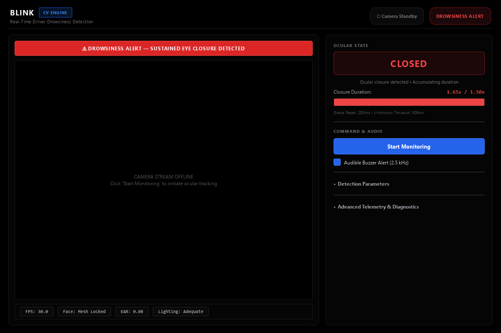
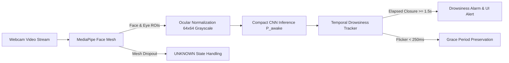

# Blink | Real-Time Driver Drowsiness Detection

[](https://www.python.org/)
[](https://www.tensorflow.org/)
[](https://pypi.org/project/PySide6/)
[](https://developers.google.com/mediapipe)

**Blink** is a real-time computer vision system that monitors driver attentiveness through high-frequency ocular localization, deep learning eye-state classification, and temporal hysteresis tracking. It pairs a custom convolutional neural network (CNN) trained exclusively in TensorFlow/Keras with a modern, pitch-black desktop monitoring cockpit built with PySide6.

---

## Key Highlights

- **Facial Landmark Mesh Localization**: Leverages MediaPipe Face Landmarker (`face_landmarker.task`) to isolate and crop left and right ocular regions independently, maintaining robust tracking across head tilts and sustained eye closure.
- **Compact & Fast CNN Classifier**: Processes 64×64 grayscale eye crops with a lightweight convolutional architecture (1.14M parameters, 13.11 MB), achieving **98.75% test accuracy** and **98.40% sleepy recall**.
- **Temporal Drowsiness Tracker**: Implements dynamic rolling-window probability smoothing, a 250 ms open-grace reset tolerance, a 500 ms dropout timeout, and a 1.5 s sustained closure threshold to prevent false alarm flickers.
- **"Pitch Black" Desktop Interface**: Ultra-dark, high-contrast UI (`#000000` / `#050505`) with white typography, restrained electric-blue accents, emerald-green attentive indicators, and strict reservation of red strictly for genuine drowsiness alarms.
- **Autonomous & Audio Alerts**: Low-latency non-blocking audible buzzer with cooldown timers and live telemetry HUD (FPS, Eye Aspect Ratio / EAR, Blink Score, and ambient lighting diagnostics).

---

## Interface Previews

| Idle Standby | Attentive (OPEN) |
| :---: | :---: |
|  |  |

| Ocular Closure (Accumulating) | Sustained Drowsiness Alert |
| :---: | :---: |
|  |  |

---

## System Architecture



---

## Quantitative Evaluation & Model Comparison

Both models were trained using identical reproducible seeds (`SEED=42`), 64×64 grayscale inputs, and the same dataset split. Model selection was performed on the validation set, with final evaluation strictly on the holdout test set.

| Metric | Baseline FNN | Compact CNN (Blink Core) |
| :--- | :---: | :---: |
| **Architecture** | 4-Layer Dense MLP | 4-Block Conv2D + BatchNorm + Dense |
| **Parameters** | 2,262,017 | **1,141,505** (-49.5%) |
| **Model Size on Disk** | 25.92 MB | **13.11 MB** (-49.4%) |
| **Test Accuracy** | 91.43% | **98.75%** (+7.32%) |
| **Macro F1-Score** | 0.9143 | **0.9875** |
| **Sleepy Recall (Closed)** | 92.60% | **98.40%** |
| **Awake Recall (Open)** | 90.28% | **99.08%** |
| **Training Time** | ~171 s | ~786 s |

> **Evaluation Disclosure & Dataset Split Limitation**:  
> Both models were trained and evaluated on an image-level 60/20/20 split of the eye dataset (50,937 train / 16,980 val / 16,981 test). All 37 subjects are present across train, validation, and test splits. Reported test metrics demonstrate high within-subject generalization rather than zero-shot cross-subject transfer.

---

## Project Structure

```
DriverDrowsiness/
├── models/                         # Model checkpoints and vision task assets
│   ├── cnn_baseline_best.keras     # Verified best CNN checkpoint (13.1 MB)
│   ├── cnn_baseline_final.keras    # Final-epoch CNN model checkpoint
│   ├── fnn_baseline_best.keras     # Benchmark FNN checkpoint (25.9 MB)
│   ├── fnn_baseline_final.keras    # Final-epoch FNN model checkpoint
│   └── face_landmarker.task        # MediaPipe Face Landmarker model asset
├── src/                            # Production source code
│   ├── desktop_app.py              # PySide6 desktop application ("Pitch Black" UI)
│   ├── webcam_detector.py          # Real-time CLI inference engine & tracker
│   ├── eye_extractor.py            # Landmark-based eye extraction module
│   ├── cnn_model.py                # CNN architecture definition
│   ├── fnn_model.py                # FNN architecture definition
│   ├── data_loader.py              # Data pipeline and preprocessing utilities
│   └── utils.py                    # Common evaluation and plotting helpers
├── scripts/                        # Utility & training scripts
│   ├── train_cnn.py                # End-to-end CNN training script
│   ├── train_fnn.py                # Benchmark FNN training script
│   ├── inspect_dataset.py          # Dataset verification & split inspector
│   ├── capture_ui_screenshot.py    # Headless multi-state screenshot generator
│   └── diagnose_low_light.py       # CLAHE & low-light diagnostic tool
├── tests/                          # Automated regression test suites
│   ├── test_desktop_app_headless.py# Headless UI component & signal tests
│   └── test_temporal_tracker.py    # Synthetic sequence temporal logic tests
├── results/                        # Verified metrics, plots, and training logs
│   ├── cnn_test_confusion_matrix.png
│   ├── cnn_training_curves.png
│   ├── model_comparison.json
│   └── logs/
├── notebooks/                      # Exploratory data analysis notebooks
│   └── 01_dataset_inspection.ipynb
├── requirements.txt                # Exact pinned dependencies
├── run.bat                         # One-click Windows launcher
└── README.md                       # Documentation
```

---

## Installation & Setup

### 1. Prerequisites
- **Operating System**: Windows 10/11 (or Linux/macOS with compatible virtualenv)
- **Python Version**: Python 3.10.x recommended
- **Webcam**: Standard USB or built-in webcam

### 2. Environment Setup
Clone the repository and create a virtual environment:
```bash
git clone https://github.com/Tarun-Tom/Blink
cd Blink

python -m venv .venv
```

Activate the environment:
- **Windows (Command Prompt / PowerShell)**:
  ```cmd
  .venv\Scripts\activate
  ```
- **Linux / macOS**:
  ```bash
  source .venv/bin/activate
  ```

Install dependencies:
```bash
pip install -r requirements.txt
```

---

## Launching Blink

### One-Click Launch (Windows)
Double-click `run.bat` in the project root, or execute:
```cmd
run.bat
```
The launcher automatically verifies `.venv` presence, sets working directories, launches the desktop application, and keeps console error messages open upon exit.

### Manual Command-Line Launch
Launch the PySide6 Desktop Application:
```bash
python src/desktop_app.py
```

Launch the Standalone OpenCV CLI Detector:
```bash
python src/webcam_detector.py --camera-id 0 --threshold 1.5
```

---

## Verification & Automated Tests

To ensure pipeline stability and verify logic without opening physical windows, run the headless test suites:

```bash
# Run headless desktop UI component tests (4/4 PASS)
python tests/test_desktop_app_headless.py

# Run temporal tracker synthetic sequence tests (4/4 PASS)
python tests/test_temporal_tracker.py
```

---

## Dataset Attribution

The ocular classification models were trained on the **MRL Eye Dataset**, a large-scale collection of human eye crops captured under varied illumination conditions, head poses, and optical glasses reflections.
- **Reference**: Large-scale dataset of human eye images for driver drowsiness detection.
- **Classes**: `awake` (open eyes) and `sleepy` (closed eyes).
- **Format**: 64×64 single-channel normalized grayscale images.

---

## Known Limitations & Considerations

1. **Extreme Low-Light Environments**: Standard RGB webcams suffer from sensor noise in near-zero light conditions. An ambient luminance warning (`Lighting: Dim`) will trigger to inform the driver when illuminance drops below threshold.
2. **Heavy Tinted Eyewear**: Extremely dark or polarized sunglasses can obstruct ocular landmarks; in such events, the system conservatively transitions to `UNKNOWN` rather than reporting an incorrect closure.
3. **Subject Overlap in Dataset**: Due to the image-level split of the benchmark dataset, performance on entirely novel subjects may exhibit slight variance compared to the 98.75% benchmark test accuracy.

---

## License

This project is licensed under the MIT License - see the `LICENSE` file for details.
